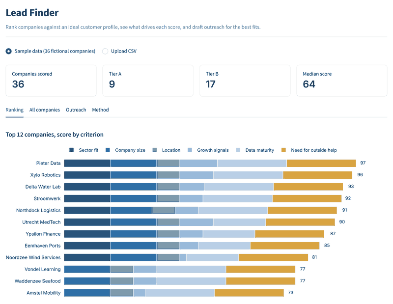

# Lead Finder

A small tool for business development: rank a list of companies against an ideal customer profile, see what drives each score, and draft outreach for the best fits.

I built it because the hardest part of business development is deciding who to contact first, and why. Author: [Aafan Khan](https://www.linkedin.com/in/aafan-khan).



## The problem

Outreach lists tend to be long and loosely targeted, and messages end up generic. A clear target profile and a ranking you can explain make it easier to spend time on the right companies.

## What it does

1. **Define who you're looking for**: target sectors, company size, cities and whether the company already has an AI team. Start from a preset (*B2B AI services* or *Small organisations & non-profits*) or build your own.
2. **Score every company (0–100)** on six transparent criteria, each with a weight you control:

   | Criterion | What it rewards |
   |---|---|
   | Sector fit | Company is in a target sector |
   | Company size | Inside the target band, fading outside it |
   | Location | In a target city |
   | Growth signals | Recent funding and active hiring |
   | Data maturity | Enough data to build something useful |
   | Need for outside help | No in-house AI team yet |

3. **Explain the ranking**: a stacked bar chart shows how many points each criterion contributed, and every company gets a plain-English "why this score" line. Leads are grouped into A, B and C tiers (off-sector companies are capped at B).
4. **Draft the outreach**: a LinkedIn note (checked against the 300-character limit), a first email with one concrete project idea and an opt-out line, and a follow-up. With an Anthropic API key, Claude can make the email more personal using only the company's facts.
5. **Export a tracker**: download the ranked list as a CSV with status and follow-up columns.

## Run it

```bash
pip install -r requirements.txt
streamlit run app.py
```

Use the built-in sample (36 **fictional** companies) or upload your own CSV with at least `company`, `sector` and `employees`. Optional columns: `city`, `funding_stage`, `months_since_funding`, `open_roles`, `data_maturity` (1–5), `has_ai_team`, `contact_role`, `website`, `notes`.

Optional AI rewrite: copy `.streamlit/secrets.toml.example` to `.streamlit/secrets.toml` and add your `ANTHROPIC_API_KEY`.

## Project structure

```
app.py                  Streamlit interface
leadfinder/scoring.py   Profiles, presets, scoring, tiers and explanations
leadfinder/outreach.py  Message drafts and optional Claude rewrite
data/                   Fictional sample data and its generator
tests/                  Unit tests (pytest)
```

## Tests

```bash
pytest -q
```

## Responsible use

The sample data is fictional. When using real data, only contact business addresses, keep messages relevant and always include an opt-out, in line with GDPR and Dutch rules on commercial email.

## License

MIT
